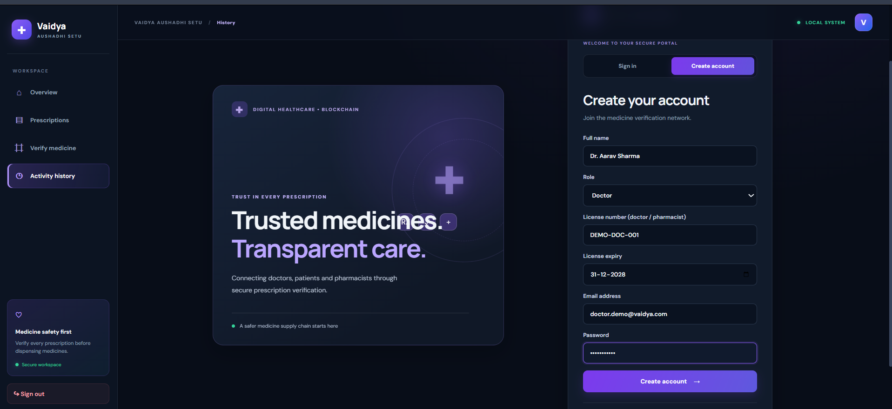

# Vaidya Aushadhi Setu
### Blockchain-Based Prescription Management and Medicine Verification System

Vaidya Aushadhi Setu is a healthcare technology project designed to improve the security, transparency and traceability of digital prescriptions. It uses blockchain technology and IPFS-based storage to support prescription verification and help reduce the risk of forged or tampered prescriptions.

## 1. Problem Statement

Traditional paper-based prescriptions can be lost, copied, modified or misused. Pharmacies may also find it difficult to verify whether a prescription is genuine.

Vaidya Aushadhi Setu aims to provide a digital system in which prescriptions can be created, stored, accessed and verified through a structured workflow.

## 2. Project Objectives

- Digitise the prescription management process.
- Provide separate access for doctors, patients and pharmacists.
- Generate a unique QR code for prescription verification.
- Use IPFS to store prescription-related data in a decentralised manner.
- Use blockchain records to support tamper-evident verification.
- Help pharmacists verify prescription details before dispensing medicines.
- Maintain prescription history for authorised users.

## 3. User Roles

| Role | Responsibilities |
|---|---|
| Doctor | Register, log in, create prescriptions and view prescription history |
| Patient | Log in and view their prescriptions |
| Pharmacist | Verify prescriptions using QR codes and update delivery status |

## 4. Main Features

### User Registration and Login
Users can create accounts and log in according to their role. Doctor and pharmacist accounts can include professional licence information.

### Digital Prescription Creation
Doctors can create digital prescriptions containing patient details, medicine names, dosage, duration and instructions.

### QR Code Generation
A QR code is generated for a prescription. It can be scanned or uploaded through the verification section to retrieve the associated prescription record.

### IPFS Storage
IPFS (InterPlanetary File System) can be used to store prescription-related content and retrieve it using a content identifier (CID).

### Blockchain-Based Verification
The blockchain component is intended to maintain verifiable prescription records or references. This helps make unauthorised changes easier to detect.

### Pharmacist Verification
A pharmacist can scan or upload a prescription QR code and check the prescription information before updating its delivery status.

### Prescription History
Doctors can view previously created prescriptions, while patients can access their prescription records through their accounts.

## 5. How the System Works

1. A user registers and selects a role: Doctor, Patient or Pharmacist.
2. The user logs in to the relevant dashboard.
3. A doctor creates a prescription for a patient.
4. Prescription information is processed by the Flask backend.
5. The prescription data or its reference is stored using the project's IPFS and blockchain components.
6. The system generates a QR code linked to the prescription.
7. The patient can access the prescription.
8. The pharmacist scans or uploads the QR code.
9. The system retrieves the corresponding record and displays verification information.
10. The pharmacist can update the delivery status.

**Note:** The exact storage and verification sequence depends on the deployed configuration of the backend, IPFS and smart contract.

## 6. System Architecture

The project consists of these main layers:

- **Frontend:** HTML, CSS and JavaScript provide the user interface.
- **Backend:** Python Flask handles API requests, authentication and prescription operations.
- **Database:** MySQL stores user information and application records.
- **Blockchain:** Ganache provides a local blockchain development environment; Solidity smart contracts handle the blockchain operations implemented in the project.
- **Decentralised Storage:** IPFS is used for content-addressed storage of prescription-related data.
- **QR Code:** Connects the prescription workflow with the verification process.

### Architecture Flow

```text
Doctor / Patient / Pharmacist
              |
              v
       HTML / CSS / JS
           Frontend
              |
              v
        Python Flask API
              |
       +------+------+
       |      |      |
       v      v      v
     MySQL   IPFS  Smart Contract
                     |
                   Ganache
       |
       v
  Prescription Data
       |
       v
   QR Generation
       |
       v
 Pharmacist Verification
```

## 7. Technologies Used

| Technology | Purpose |
|---|---|
| HTML | Webpage structure |
| CSS | User interface styling |
| JavaScript | Frontend functionality and API communication |
| Python | Backend programming |
| Flask | REST API development |
| MySQL | Relational database |
| Solidity | Smart contract development |
| Ganache | Local blockchain testing |
| IPFS | Decentralised content storage |
| QR Code | Prescription identification and verification |

## 8. Project Modules

1. User Registration and Authentication
2. Role-Based Dashboards
3. Digital Prescription Creation
4. Prescription Storage
5. QR Code Generation
6. Prescription Verification
7. Medicine Delivery Status
8. Doctor Prescription History

## 9. Installation and Setup

### Prerequisites

Install the following software:

- Python 3
- MySQL Server
- Node.js and npm
- Ganache
- IPFS/Kubo
- Git

### Step 1: Clone the Repository

```bash
git clone https://github.com/YOUR-USERNAME/Vaidya-Aushadhi-Setu.git
cd Vaidya-Aushadhi-Setu
```

### Step 2: Set Up the Python Backend

Open a terminal in the backend folder:

```bash
cd backend
python -m venv venv
```

Activate the environment on Windows:

```bash
venv\Scripts\activate
```

Install the required packages:

```bash
pip install -r requirements.txt
```

Create your local environment configuration using the example environment file and add your own database credentials. Never publish your real `.env` file.

### Step 3: Set Up MySQL

1. Start MySQL Server.
2. Create the project database.
3. Import the SQL schema supplied in the `database` folder.
4. Configure the database connection using your local environment variables.

### Step 4: Start the Blockchain

1. Open Ganache.
2. Start your local blockchain.
3. Deploy the project's smart contract using the supplied deployment script.
4. Update the local contract address and network configuration.

### Step 5: Start IPFS

Start your local IPFS node using the commands appropriate for your installed IPFS/Kubo version. Confirm that the node is running and that the backend can connect to it.

### Step 6: Run the Flask Backend

```bash
python app.py
```

The backend is expected to run at:

```text
http://127.0.0.1:5000
```

### Step 7: Run the Frontend

Open the frontend `index.html` in a browser, or use a local development server if your frontend setup requires one.

## 10. Example Use Case

A doctor creates a prescription for a patient. The system generates a QR code associated with that prescription. The patient presents the QR code at a pharmacy. The pharmacist scans it, checks the prescription record and updates the delivery status.

## 11. Future Enhancements

- Deployment to a public blockchain test network.
- Stronger identity and professional licence verification.
- Secure patient consent and access controls.
- Medicine batch and expiry tracking.
- Notifications for patients and pharmacists.
- Improved audit logs and reporting.
- Cloud deployment and production-grade security.
- Mobile application integration.

## 12. Important Project Scope

This repository represents an academic software prototype. It is intended for learning and demonstration. It is not a certified medical system and should not be used to make clinical decisions or process real patient prescriptions.

Blockchain and IPFS functionality depends on the configured network and running services. A local Ganache setup is a development environment, not a public production blockchain.

## 13. Author

**Project:** Vaidya Aushadhi Setu  
**Domain:** Healthcare Technology, Blockchain and Web Development  
**Project Type:** Academic Project

## 14. License

This project is available for academic and learning purposes. Add a formal open-source licence if you intend to grant others permission to reuse, modify or distribute the code.
## Project Preview

<p align="center">
  
</p>